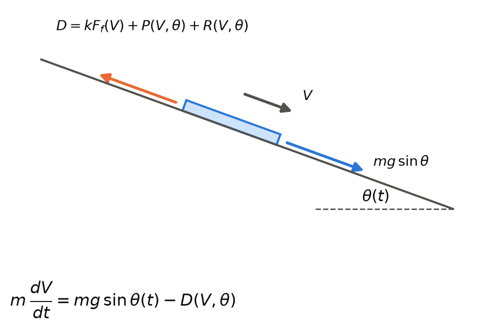

# 📘 Virtual Surfer — a surfboard's speed from SWD's forces

MMA3001 Numerical Methods and Machine Learning — individual project.

A physics-based hydrodynamic solver (ShaperWaveDynamics, "SWD") gives the forces on a surfboard at a
fixed attitude, but no trajectory. It never says how fast a board travels down a wave face. This
repository supplies that missing step. It:

- builds the friction drag on the board's bottom from boundary-layer theory;
- adds SWD's own planing and rail drag from its live solver;
- integrates the board's speed along the face with RK4.

The equations the code implements are the author's derivations. Each is recorded, with the choices
behind it, in [`AI-USE.md`](AI-USE.md) § 4.

This README describes the project as it ended. The two subsections below say where it began and
where it goes next.

### 🔹 Where it began

The project set out to build a "Virtual Surfer": a machine-learning surrogate trained on SWD's
hydrodynamic output, queried along a synthetic trajectory on the wave, feeding two performance
indicators of Charles et al. That first stage, Part A, had three pieces:
- the surrogate, an SVR compared with a decision tree, a 5-nearest-neighbour model and a physics
  baseline, trained on 13 boards and scored leave-one-board-out;
- the first trajectory model, `trajectory.py`, with its two indicators;
- a first identifiability screen built on that model.

Claude Code produced Part A from very high-level instructions, and the author did not oversee it
closely while it was being produced. As a result he could not attest its tests, and on
28 October 2026 he removed it from the repository (`AI-USE.md` § 4). The trajectory model also
carried a known error: it summed 7–12 scan positions per roll case, which inflated its forces
(`AI-USE.md` § 5 E133). The removed files are archived outside the repository and remain in its
git history up to commit `718c0e0`. The prompts that built them stay in `AI-USE.md` § 6.

What remains, Part B, was built the other way round. The author derived the equations, and every
grid and tolerance in its tests is his (section 5).

### 🔹 Where it goes next: the inverse PINN

The forward model answers one question: given the forces, how does the board move? The planned next
stage asks the inverse one: given the board's measured acceleration, how large is its friction? A
physics-informed neural network (PINN) adds something only in that inverse mode. Run forward, the
equation of motion is an initial value problem that RK4 already solves (`AI-USE.md` § 2,
2026-10-23). What has been decided so far, all recorded in `AI-USE.md` § 4:

- Synthetic data comes first, then the inverse PINN, then a least-squares model-mismatch study.
  All three were deferred on 27 October 2026, to leave time to make each decision without skipping
  important choices to meet a due date.
- The PINN's physics is the Blasius equation and the von Kármán momentum integral (22 October).
  Falkner–Skan, a third candidate, was dropped because SWD has no pressure gradient for it to
  describe. Blasius needs an initial condition, f″(0), which comes from RK4 shooting first
  (23 October). `src/friction/blasius_shooting/` computes it, and F_f is built on it.
- The unknown is a friction multiplier k on F_f, recovered from the along-path acceleration
  sampled at about 15 Hz, the rate of the paper's own board sample (mmc1).
- The starting speed V0 is to be treated as measured with an uncertainty, neither known exactly
  nor fitted freely (27 October). Its source is not chosen yet: the MS5837's dynamic pressure, or
  GPS.
- The noise is, for now, the 0.01 g resolution floor, σ = 0.0981/√12 = 0.0283 m/s², from the
  author's own derivation (27 October). The ICM-20948's own noise is to be added later.
- Step 1's spec suggested generating the synthetic data with `solve_ivp` and fitting it with RK4,
  so the fit is never tested on data its own integrator made. The author kept RK4 for Step 1 and
  left `solve_ivp` for later (27 October, E17).
- The feasibility evidence is the live-solver identifiability screen and its Gate B rerun
  (section 5). They ask whether a least-squares fit can recover a planted k = 1.10 from that
  acceleration above the noise. Neither has a verdict yet; the author decides.

Not yet decided: the network, its loss terms and their weights, and the training data. One
constraint is already known. The inverse fit would use the forward model's 3 s run, and at this
attitude the forward model leaves the force data at 5.07 s. So the inverse work needs a longer run
inside the data, or it accepts the 3 s start dependence of the screen's set (b) (28 October).

---

## 📂 1. What is in here

    HYDRODYNAMICS-FIN/
    ├── src/
    │   ├── friction/                 friction drag F_f(V) on the board bottom
    │   │   ├── blasius_shooting/     Blasius by RK4 shooting, a central-difference check,
    │   │   │                         the layer thicknesses and the skin friction
    │   │   ├── von_karman/           the Kármán momentum integral, Majdalani–Xuan quartic
    │   │   ├── friction_force.py     F_f(V) on the live solver's wetted area and length
    │   │   └── rerun_live_screen_ff.py   Gate B: the second screen re-run with F_f
    │   ├── forward_model/
    │   │   └── forward_model.py      V(t) down the face: the author's E15 and E16, by RK4
    │   └── swd_model/                the live-solver identifiability screen, for the inverse PINN
    ├── tests/                        pytest: 272 pass
    ├── docs/                         pdoc HTML, generated
    ├── figures/                      the README's figures
    ├── SWD/                          the data acquired from SWD, and its documentation (section 6)
    ├── tools/                        regenerates the prompt appendix in AI-USE.md
    ├── AI-USE.md                     the AI-use record (section 8)
    ├── AGENTS.md, GEMINI.md          instructions for the agy and Devin reviewers
    └── requirements.txt, pyproject.toml

Every folder under `src/` is a Python package, so modules import each other as
`from src.friction import friction_force`. The Jupyter notebooks sit beside the modules they
exercise, in `src/friction/blasius_shooting/` and `src/friction/von_karman/`.

**`src/` and `SWD/` are separate on purpose.** `SWD/` holds what was taken out of a licensed
third-party application. `src/` is the modelling. Code in `src/` writes only into the `computed-data/`
folders under `SWD/data/`, and never into the extracted CSVs.

---

## 📂 2. Setup

Python **3.12 or newer** (developed on 3.14.6). No virtual environment is assumed.

```bash
pip install -r requirements.txt
```

| Package | Why |
|---|---|
| numpy, pandas | array and table handling |
| scipy | PCHIP interpolation, Simpson's rule, root-finding, least squares |
| matplotlib | the screen's figures and the notebooks' plots |
| pytest | the test suite |
| pdoc | HTML API documentation |

Run everything from the repository root. The modules are a package, so a script runs as
`python -m src.<package>.<module>`, not by its file path.

### 🔹 Optional: Obsidian and Claude Code

The repository root is also an Obsidian vault. Project notes link to each other with relative
Markdown links, and the worklist is a Base (`SWD/docs/worklist/worklist.base`). Claude Code's memory
for this project lives in `memory/`, which is local and gitignored. None of this is needed to run the
code.

1. Clone the repository.
2. Install Obsidian **1.12.7 or newer from the installer**. The in-app updater does not create
   `Obsidian.com`, which the command-line interface needs on Windows.
3. Open the repository folder as a vault and allow community plugins.
4. Settings → General → **Command line interface** → Register, then restart the terminal.
5. Enable the **Local REST API** community plugin. In its settings, turn on the non-encrypted
   HTTP server on `127.0.0.1:27123`. Copy the API key into a user environment variable, then
   restart the terminal:

   ```powershell
   [Environment]::SetEnvironmentVariable('OBSIDIAN_API_KEY', '<key>', 'User')
   ```

6. Point Claude Code's memory at your own clone. Run this from the repository root:

   ```powershell
   New-Item -ItemType Directory -Force memory | Out-Null
   [IO.File]::WriteAllText("$PWD\.claude\settings.local.json", '{"autoMemoryDirectory": "' + ((Resolve-Path memory).Path -replace '\\','/') + '/"}')
   ```

7. Start `claude`, trust the folder, and approve the `obsidian` MCP server when asked.

> ### 🧩 Point of note
> Sync the vault with git, not Obsidian Sync. Every collaborator on a Sync shared vault needs
> their own paid subscription, the Standard plan rejects files over 5 MB, and two sync engines
> on one folder can lose edits. `.obsidian/workspace*.json` and each plugin's `data.json` (which
> holds your API key) are gitignored.

---

## 📂 3. Reproducing the results

Every number quoted in section 5 comes from these commands.

### 🔹 Run the tests

```bash
python -m pytest tests/ -q
```

### 🔹 The forward model

```bash
python -m src.forward_model.forward_model    # the author's run: t, theta, V and a every 0.5 s
```

```python
from src.forward_model import forward_model as fm

t, V, a, complete = fm.simulate()            # 20 -> 0 deg over 3 s from 6 m/s, h = 0.001 s
fm.simulate(V0=6.5, k=1.1)                   # another start speed, friction scaled by 1.1
```

### 🔹 The friction force

```python
from src.friction import friction_force as ff
from src.friction.von_karman import von_karman as vk

A, L = ff.wetted_geometry()                  # the live solver's wetted area and length, pos_x 0.45
ff.F_f([2.0, 8.3], A, L)                     # N, Blasius laminar run
ff.F_f(8.3, A, L, laminar_avg_C_f=vk.avg_C_f)   # the Kármán laminar run instead
```

The Blasius and Kármán checks are notebooks, opened from their own folders:
`src/friction/blasius_shooting/rk4_blasius_checks_cc.ipynb`, `fd_vs_shooting_cc.ipynb`,
`shooting_for_blasius.ipynb` and `src/friction/von_karman/vonkarman.ipynb`.

### 🔹 The screen and Gate B

```bash
python -m src.swd_model.identifiability_screen_live    # the live-solver screen, about 7 minutes
python -m src.friction.rerun_live_screen_ff            # Gate B: the same screen with F_f
```

### 🔹 Regenerate the HTML documentation

```bash
python -m pdoc --math --docformat numpy -o docs src
```

pdoc renders default arguments, which writes the absolute path of your checkout into the HTML. The
committed `docs/` has those paths cut back to repo-relative ones (`SWD/data/…`).

---

## 📂 4. Inputs and outputs

### 🔹 The forward model, `simulate()`

$m\,dV/dt = m g \sin\theta(t) - D(V, \theta)$, with $D = k F_f(V) + P(V, \theta) + R(V, \theta)$. P and R are
SWD's planing and rail drag at the slope θ, from the live solver at pos_y 0, pos_x 0.45, drift 0.
m = 802.21 N / 9.81 m/s².



*Forces along the face on the board. D opposes the motion; gravity drives it through the slope θ(t).
Drawn by a Claude chat (`AI-USE.md` § 2).*

| Input | Type | Unit | Range (default) | Domain |
|---|---|---|---|---|
| `V0` | float | m/s | 2–10 (6) | inside the force data |
| `k` | float | — | ≥ 0 (1) | multiplies F_f |
| `theta_start`, `theta_end` | float | degrees | −10 to 20 (20, 0) | inside the force data; positive is downhill |
| `T` | float | s | > 0 (3) | ramp and run length |
| `h` | float | s | > 0 (0.001) | T/h a whole number of steps |

| Output | Type | Unit | Meaning |
|---|---|---|---|
| `t` | float array | s | 0, h, …, up to T |
| `V` | float array | m/s | speed along the face at each node |
| `a` | float array | m/s² | dV/dt from the equation of motion at each node, not a finite difference |
| `complete` | bool | — | False if the run stopped because V left 2–10 m/s |

**Invalid input handling.** A non-finite, non-scalar or out-of-range input raises `ValueError`
naming the input, as does a step that does not divide T. Nothing is extrapolated: a run whose
speed leaves the force data stops at the last node inside it and returns `complete = False`.

### 🔹 The friction force, `F_f(V, A, L)`

| | Type | Unit | Range | Domain |
|---|---|---|---|---|
| `V` (input) | float or array | m/s | > 0, finite | inside the converged speeds of A and L (2–10 m/s here) |
| `A`, `L` (input) | callables | m², m | from `wetted_geometry()` | not extrapolated |
| `rho`, `mu` (input) | float | kg/m³, Pa·s | SWD's 1025 and 0.00107 | finite, > 0 |
| `F_f` (output) | float or array | N | ≥ 0 | the same shape as V |

The transition point sits at Re = 5×10⁵, SWD's value, capped at the wetted length. The laminar run uses
the Blasius average coefficient from the shooting by default, and the turbulent run uses SWD's
0.031/Re_L^(1/7).

---

## 📂 5. Results, including the parts that did not work

Every grid and tolerance in the tests is the author's, chosen from tables of measured values before
any tolerance was written (`AI-USE.md` § 4).

### 🔹 The friction force

| Check | Result |
|---|---|
| RK4 (the author's `rk4_solve`) on y″ + 4y = 0 | fourth order: observed order p_obs → 4 |
| Blasius f″(0) by RK4 shooting, settled at η∞ = 20, against White's σ/√2 | within 8.9×10⁻¹² |
| A second-order central difference on the same grid | f″(0) within 1.7×10⁻⁵, against shooting's 1.5×10⁻⁸, in about a quarter of the time |
| Layer thicknesses against White and Majdalani, Table 4-4 | η₉₉ within 1.4×10⁻⁷; δ*/δ₉₉ to the table's 5 decimals; θ and H 2×10⁻⁴ out, the trapezoid's error |
| Skin friction C_f√Re_x from the shot | 4.3×10⁻⁹ from 2σ/√2 |
| Kármán integral with the Majdalani–Xuan quartic, Table 4-1 | all six values within half the last printed digit; C_f 0.517 % above Blasius; RK4 march p_obs = 4.069 |
| F_f against SWD's own friction, pos_x 0.45, 2–10 m/s | 0.985–0.989 of it |

### 🔹 The alternatives compared

The brief asks for at least one alternative, compared with evidence (p. 5). Two are implemented,
and both are measured in the table above.

| Used | Alternative | Evidence | Choice |
|---|---|---|---|
| Blasius f″(0) by RK4 shooting | a second-order central difference on the same grid | f″(0) within 1.5×10⁻⁸ against the difference's 1.7×10⁻⁵, which takes about a quarter of the time | shooting, for F_f |
| the Blasius laminar law in F_f | the Kármán integral with the Majdalani–Xuan quartic | its C_f sits 0.517 % above Blasius | Blasius by default (`AI-USE.md` § 4); Kármán through `laminar_avg_C_f=vk.avg_C_f` |

### 🔹 The forward model

- The author's run, 20° → 0° over 3 s from 6 m/s, stays inside the force data: 6.00 → 7.31 m/s at
  1.5 s → **6.09056 m/s** at 3 s.
- RK4 against the author's closed form for m dV/dt = −cV²: p_obs = 3.990 on h = 3/96 to 3/384 s,
  with the error at h/4 inside the h/2 → h/4 change.
- Held at a constant 10°, a run from 6 m/s settles to within 0.034 m/s of the steady speed
  V* = 7.306 m/s after 30 s.
- SWD's own `drag_total_n`, which the model never uses as a force, crosses zero at 7.2926 m/s on
  the same slope (linear between 7 and 8 m/s). The model's V* is 0.0135 m/s away. This is the one
  check against an output the model does not consume.
- The author's first schedule failed. −10° → 20° over 10.055 s left the 2–10 m/s force data
  within 0.5–2.6 s for every starting speed from 4 to 10 m/s, so the ramp was changed to 20° → 0°
  over 3 s.

### 🔹 The screen and Gate B

The live-solver identifiability screen (2026-10-24) measured how well a fit recovers a friction
multiplier k from acceleration sampled at about 15 Hz. Gate B re-ran it with F_f in place of SWD's
friction: every spread of the fitted k is 0.2–5.6 % wider. **Neither gate has a verdict yet;**
the author decides. A first screen, built on the removed trajectory model, left with Part A.

### 🔹 What this validation cannot establish

- The forward model runs at one attitude (pos_y 0, pos_x 0.45, drift 0), along one axis down the
  face: no roll, yaw, added mass or unsteady force. Its forces exist only at 2–10 m/s and −10° to
  20°.
- SWD's rows do not decompose exactly. At that attitude, `drag_total_n` minus
  (friction + planing + rail − W sin θ) is within 4.3 N up to 15°. It reaches −10.2 N at 20° and
  −22.1 N at (2 m/s, −10°).
- The screen's set (b), which fits k and V0 together, is taken at 3 s to match the forward model's
  3 s run. At 3 s its fits depend on the optimiser's starting point and on the V0 ≤ 10 m/s bound:
  about 22 % of them stop on the bound, so its V0 spread is not what the data alone give. At
  10.055 s, mmc1's full wave, only 3 % do at the lower noise level, but the forward model cannot
  run that long at this attitude: held at 0° after its ramp, it leaves the force data at 5.07 s.
---

## 📂 6. The data acquisition half

`SWD/` holds what was acquired from SWD:
- the extracted CSVs in `SWD/data/`;
- the live solver's tables;
- the documentation of how they were made, in `SWD/docs/` and `SWD/README.md`.

Nothing in `src/` writes into the extracted data.

The PowerShell that did the acquisition has been kept out of the public repository since
2026-10-28. That is the binary-report extractor, the `SWD/tools/phase2/` scripts that drove the live
application through Win32 messages and UI Automation to acquire new scans, and their Pester tests.
They need **Windows PowerShell 5.1** (`powershell.exe`, not `pwsh` 7) and a licensed SWD installation;
nothing in `src/` needs either. The extractor was read-only against the
installation: it never launched SWD, never wrote into the program directory, and never modified a
library file in place. Its provenance gate would not deserialise a file whose SHA-256 was absent from
a trust manifest, because `BinaryFormatter.Deserialize` on an untrusted stream is arbitrary code
execution.

The Python helpers in `SWD/tools/` (the column translation, the data dictionary and the computed
views) stay in the repository.

---

## 📂 7. Licence and attribution

See `LICENSE`. This project uses the supplementary data of Charles et al. (2026),
*Results in Engineering* 29:108868, DOI 10.1016/j.rineng.2025.108868. That data is
redistributed here under CC BY 4.0 with attribution recorded in
`SWD/data/paper-supplementary/SOURCE.md`; the paper itself is cited, not redistributed.

The boundary-layer reference values come from White and Majdalani, *Viscous Fluid Flow* (2022),
chapter 4: Table 4-1 (p.158), Table 4-4, and Eq. 4-64 (p.170).

SWD itself is commercial software and none of it is redistributed here — only measurements
taken from a licensed installation.

---

## 📂 8. How AI was used, and how it was checked

The unit's project brief permits AI throughout the project, requires that all material use be
disclosed, and lists eight things the reflection must explain (Project Brief, p. 6). It also says,
in bold, that AI cannot be used to answer questions in the interview — so everything here has to
be explicable by the author without it. The full record is [`AI-USE.md`](AI-USE.md); this section
says where each answer is and how the checking worked.

| The brief asks for | Where it is answered |
|---|---|
| which AI tools were used | `AI-USE.md` § 1 |
| what they were used for | `AI-USE.md` § 2 |
| the approximate level of AI contribution | `AI-USE.md` § 3 |
| why AI was used for those tasks | `AI-USE.md` §§ 2–3 |
| how AI-generated material was checked | below, and `AI-USE.md` § 5 |
| which important decisions remained the student's responsibility | `AI-USE.md` § 4 |
| any errors, limitations or unhelpful suggestions produced by AI | `AI-USE.md` § 5 |
| how AI use affected the student's understanding or workflow | `AI-USE.md` § 4, and below |

### 🔹 The tools

| Tool | Version | Model | Used for |
|---|---|---|---|
| Claude Code (Anthropic) | 2.1.246–2.1.311 | `claude-opus-5`; `claude-opus-5-5` from 23 Sep 2026 | writing and editing code and documents under direction — 42 sessions, 435 prompts, 26 Aug – 27 Oct 2026 |
| SQA-loop agents, run inside Claude Code | as installed Aug 2026; rebuilt 27 Sep 2026 | `claude-opus-5`, then `claude-opus-5-5` | reviewing and fixing that code — 15 review dispatches and 6 fix rounds in Aug–Sep 2026; read-only `sqa-numerical` and `sqa-functional` reviews in Oct 2026 |
| humanizer plugin | 2.11.2 | the session's model | five prose passes over this README, the latest on 28 Oct 2026, each followed by a fact diff |
| graphify | 0.9.52 | none for code | a navigation graph of the repo; gitignored, not a deliverable; retired 14 Sep 2026 |
| Claude (claude.ai chat) | not recorded | not recorded | drew the forces diagram in section 4 (Figure F1 of the report's appendices) |
| Google Antigravity CLI (agy) | 2026-09 onwards | Gemini (3.8 Flash, 3.1 Pro, 4 Argon, as selected) | auditing and fixing the SWD extraction code (24–25 Sep 2026); since 27 Sep, the first stage of the SQA pass; from Oct 2026, review-only checks of the friction, forward-model and jerk-cost code |
| Devin CLI (Cognition) | 3000.11.3 | `swe-1-7` | drafting the second-source auditor config (24 Sep 2026); since 27 Sep, the second stage of the SQA pass; from Oct 2026, the second review-only check |

`pdoc`, `pytest`, `Pester` and `PSScriptAnalyzer` are not AI and are listed only so the question
does not arise.

### 🔹 Verification by agentic review — the SQA loop

Code that an AI wrote was reviewed by AI agents that could not edit it, fixed by an agent that
could not grade its own work, and re-reviewed by a fresh instance every round. The tooling is
[bennmoors/SQA-loop](https://github.com/bennmoors/SQA-loop); the process, in brief:

1. **`sqa-lead`** scopes the target and dispatches specialists in parallel by domain —
   `sqa-functional` (correctness, ISTQB test design), `sqa-security` (OWASP/ASVS, secrets, data
   leaks), `sqa-efficiency` (profiling and energy), and `sqa-embedded` / `sqa-numerical` when the
   target warrants them. Every finding carries an evidence label (`[Proven]`, `[High]`,
   `[Needs-info]`), and only the first two can raise the severity count.
2. The merged report ends in one parseable line, **`VERDICT: Critical=N | Warning=N |
   Suggestion=N`**, which is the gate: loop while Critical or Warning is above zero.
3. **`code-reviewer`** — the only agent allowed to edit — takes the findings verbatim and either
   fixes each one or rebuts it with evidence. It never drops a finding silently.
4. A **fresh `sqa-lead`** verifies. The instance that reviewed is never the one that certifies the
   fix. The table below is the reason: the fixer's own verdict and the verifier's disagreed in
   every round where both exist.
5. Two `PreToolUse` guards enforce this at the harness, so it does not depend on an agent obeying
   its prompt. An SQA agent that tries to write a file is refused, and so is the fixer when it
   reaches for the tests or the scoring script.

What that produced here, copied from the repo's own worklists:

| Target | Intake | After fix (fixer's own verdict) | Fresh verifier | Source |
|---|---|---|---|---|
| Phase 1 extractor (`swd_extract.ps1`), three rounds | `C=3 W=5 S=19` | `C=1 W=0 S=5` (the Critical is a security patch parked for sign-off) | **`C=1 W=3 S=5`** — its Critical was a hole in a guard the fix rounds themselves had added | `SWD/TODO.md`, "SQA round 1" to "Final verification" |
| Phase 2 UI automation (`swd_msg.ps1`, `swd_diagnose.ps1`), round 1 | `C=6 W=11 S=14` | `C=0 W=0 S=2` | **`C=1 W=4 S=8`** | `SWD/TODO.md`, "QA loop CLOSED — 2026-08-28" |
| same, round 2 | — | `C=0 W=0 S=4` | **`C=1 W=2 S=5`** | same |
| same, round 3 (closed at the round cap) | — | `C=0 W=0 S=3` | **`C=0 W=7 S=11`** | same |
| Extraction and census scripts (`extract_board.ps1`, `census_board.ps1`) | `C=1 W=9 S=24` | `C=0 W=1 S=1` | **`C=1 W=14 S=20`**, then a third fixer round reported `(CLEAN)` with 67/67 Pester — closed at the cap on the fixer's word, not a verifier's | `SWD/data/default_shortboard/PROGRESS.md`, "SQA loop outcome" |
| UIA board switching (`swd_board.ps1`, `swd_geometry.ps1`), round 1 | `C=2 W=16 S=17` | `C=0 W=0 S=2` (2 deferred with reasons, 1 rebutted) | **`C=2 W=6 S=9`** — "fixer's CLEAN did not hold" | `TODO.md`, Tier 2b |
| same, round 3 | — | `C=0 W=0 S=2`, and the fixer found a third Critical itself that two review rounds had missed | **`C=0 W=2 S=13`**, cap reached, not clean; the two Warnings were then fixed without an independent pass | `TODO.md`, Tier 2b |

The PowerShell scripts in this table, and the root `TODO.md`, have been kept out of the public
repository since 28 Oct 2026.

> ### 🧩 Point of note — the fixer reports itself clean, and the verifier disagrees
> In each of the three Phase 2 rounds the fixing agent's own verdict was `Critical=0 | Warning=0`,
> and each time the independent verifier found more. The extraction loop went the same way: the
> fixer reported one Warning, the verifier fourteen. The UIA loop too: a fixer's clean verdict
> came back as two Criticals. In round 1 of the Phase 2 loop the fixes themselves introduced one
> new Critical and three regressions (`SWD/tools/phase2/SQA-FINDINGS.md`), and the Phase 1
> verifier's one Critical was a hole in a guard the earlier fix rounds had added. `SWD/TODO.md`
> puts it in one line: "Twice a fixer reported clean and a fresh verifier immediately found a
> Critical. That is why the verifier is never the author." It is also why the loop gates on the
> verifier's line and ignores the fixer's.

> ### 🧩 Point of note — the process changed on 27 September 2026
> Everything above describes the multi-round loop. From 2026-09-27, `/sqa-loop` is **one unattended
> pass**. A quota check first leaves out any CLI that is low on usage (no other CLI is swapped in).
> Then agy tests and fixes, and Devin tests and fixes the tree agy left. Both run headless through a
> wrapper that reverts any write outside their allowed paths. Last comes one Claude `sqa-lead` with
> its specialists and one `code-reviewer`, and that verdict is final. There is **no fresh-verifier
> round any more**, so the fixer's edits in that last step are not re-checked, which is the
> weakness the table above documents. No pass of this kind had been run on this repository as of
> 2026-09-29. From October 2026, agy and Devin ran review-only rounds through the same wrapper on
> the friction, forward-model and jerk-cost code, with Claude Code applying the fixes. Details, the
> reasons, and three faults found in trial runs: `AI-USE.md` § 2 (2026-09-26/27 and 2026-09-27) and
> § 5 E78–E80.

<!-- REVIEW: drafted from AI-USE.md § 4 (2026-10-28) and the author's prompt by Claude Code. Rewrite it in
     your own words, change what is not true, and delete this comment. Exempt from style passes. -->

### 🔹 What Part A taught about using AI

The project's first stage, Part A (the surrogate, the first trajectory model and the first screen),
was produced from very high-level instructions, and I did not oversee it closely while it was being
produced. Its tests passed, but I could not attest them. On 28 October 2026 I removed it from the
repository, and the original goal it served changed with it. Part B was built the other way: I
derived each equation and chose each grid and tolerance before the code that tests them was
written, and Claude Code implemented them. The prompts that produced Part A stay in `AI-USE.md`
§ 6, and the decision is recorded in § 4.

### 🔹 Errors the AI made

The brief's Excellent band asks for "identification of errors", and its Poor band names
"unrecognised errors". The acquisition half already carries its own acknowledgement,
`SWD/README.md` § AI Acknowledgment, which names five. `AI-USE.md` § 5 indexes every correction
recorded anywhere in the repository — E1 to E160 as of 27 Oct 2026, starting from 62 harvested from
the project's documents. Four that changed the work:

- An AI-written note computed `rho = 1023.154` with a "0.015% density residual" and inferred a
  second flow speed of 20.039 m/s. Both were artefacts of dividing a bimodal mixture by one assumed
  density; there was one speed at two water temperatures. Re-measuring the ratio on a single board
  caught it (`.claude/rules/swd-technical-facts.md`, moved there from `CLAUDE.md` § 5).
- A "2.7× faster at low speed" cost re-base compared two boards that had both been scanned at
  ~20 m/s, so it measured hull geometry, not speed. It was withdrawn after the live run
  (`SWD/TODO.md`, "Cost model").
- A stage plan was written against a `NumericUpDownScanSpeed*kmh` control and a km/h conversion.
  The live application has a `flow ms` box, in m/s, and the planned value would have requested
  130 km/h. Reading the control map before scanning caught it.
- `CLAUDE.md` § 2 carried a seven-row weighted marking table and a "20% withheld split with RMSE"
  requirement, both cited to the brief. The brief's rubric has six unweighted criteria and lists
  withheld data as one of ten validation options. Reading the PDF text directly while writing this
  section caught it.

### 🔹 The prompt log

`AI-USE.md` § 6 is every prompt given to Claude Code, agy and Devin for this repository — 458 across
58 sessions as of 27 Oct 2026 (Claude Code 435, agy 21, Devin 2), verbatim and timestamped. It is
recovered from the session transcripts the CLIs keep outside the repo and regenerated by
`python tools/extract_prompts.py`, which a hook has run at the end of every Claude Code session since
29 Sep 2026. The home directory is redacted; anything that looks like a licence or registry
reference is flagged for a human to check. The brief does not ask for this; it is included because
"complete disclosure" is easier to demonstrate than to assert.

---

<!-- REVIEW: drafted from AI-USE.md by Claude Code. Read every sentence, change what is not
     true in your own words, and delete this comment. This section is exempt from style passes. -->

## 🤖 AI Acknowledgment

> Parts of this repository were developed with the assistance of **Claude Code** (Anthropic; CLI
> versions 2.1.246–2.1.311, models `claude-opus-5` and `claude-opus-5-5`, accessed 26 August –
> 28 October 2026), which wrote and edited code and documentation under my direction across 42
> sessions and 435 prompts (to 27 October), and ran the **SQA-loop** review agents over its own
> output. **Google Antigravity (agy)** and **Devin CLI** audited the code, and from October reviewed
> it without editing it. The **humanizer** plugin (2.11.2) was used for five prose passes over this
> README. **graphify** (0.9.52) built a navigation graph that is not part of the submission; it was
> retired on 14 September 2026.
>
> AI was used for the SWD extraction and UI-automation scripts, the surrogate pipeline and first
> trajectory model that I later removed from the repository (Part A),
> the friction-function, forward-model and jerk-cost code in `src/` (implementing my own
> derivations), the test suites, and the drafting of the documentation. The complete record — what
> was asked, what came back, what I changed, and what it got wrong — is `AI-USE.md`.
>
> All content has been reviewed, verified and adapted by the author. Verification was by
> measurement against SWD's own output, decompilation of the solver where its formulas were in
> question, live runs against the application, the pytest and Pester suites, known-answer and
> convergence tests against my derivations and textbook values, and independent agentic review
> (with a fresh verifier every round until 27 September 2026). The errors that process caught are
> listed in `AI-USE.md` § 5 rather than hidden. I am responsible for every claim, result, reference
> and engineering decision in this repository.
